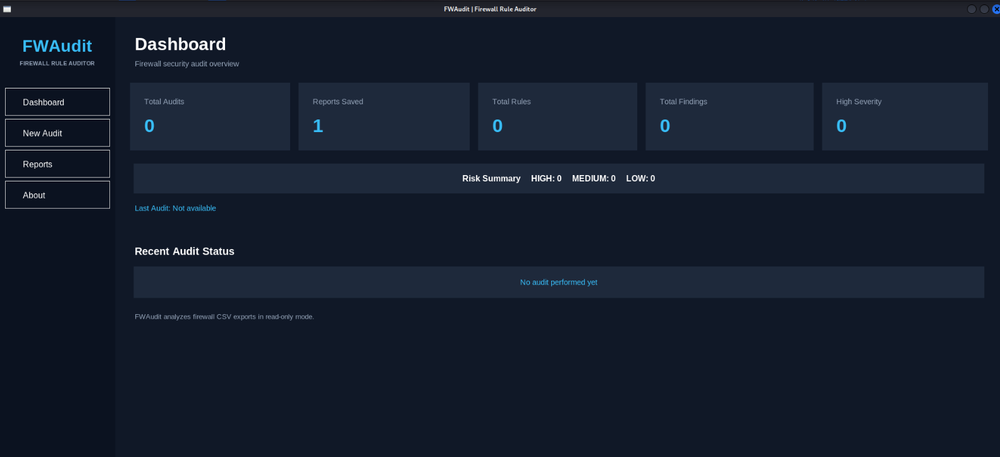

# FWAudit

### Firewall Rule Auditor

**Review Firewall Rules. Identify Security Risks. Improve Network Defense.**

A Python-based defensive security application for firewall configuration analysis, risk identification and audit reporting.

<br>


**Developed by Maisa Aslam**

---

## Overview

**FWAudit (Firewall Rule Auditor)** is a defensive cybersecurity tool developed to examine firewall rule configurations and identify potentially unsafe settings.

Firewall rules control network traffic by allowing or denying connections. Incorrectly configured rules can expose sensitive services, weaken access restrictions and create unnecessary security risks.

FWAudit analyzes firewall rule exports in CSV format and produces structured findings with severity levels and supporting evidence.

It combines a command-line auditing engine with a graphical desktop application, providing two ways to perform and review security audits.

## Application Preview

### FWAudit Dashboard



*Dashboard displaying audit statistics, security findings and risk information.*

---

## Core Capabilities

| Capability | Description |
|---|---|
| CSV Rule Analysis | Imports and validates firewall rule files. |
| Any-to-Any Detection | Identifies unrestricted allow configurations. |
| Management Port Exposure | Checks unrestricted SSH and RDP access. |
| Shadowed Rule Detection | Highlights potentially shadowed rules. |
| Logging Analysis | Identifies deny rules with logging disabled. |
| Risk Classification | Organizes findings by HIGH, MEDIUM and LOW severity. |
| Audit Reporting | Generates and saves text-based reports. |
| Dashboard | Displays audit statistics and security summaries. |
| Report Management | Opens, views and deletes saved reports. |

## Security Analysis

FWAudit performs four primary configuration checks.

### 01: Any-to-Any Allow

Identifies firewall rules that permit unrestricted traffic between any source and destination.

**Risk:** Unnecessary network exposure.

### 02: Management Port Exposure

Checks whether management services are accessible from unrestricted sources.

- SSH — Port 22
- RDP — Port 3389

**Risk:** Management services may be exposed beyond their intended access scope.

### 03: Potentially Shadowed Rules

Highlights rules that may be affected by earlier matching firewall rules.

**Risk:** Rule ordering may prevent an intended rule from being reached.

### 04: Disabled Deny Logging

Identifies deny rules where logging is disabled.

**Risk:** Reduced visibility into denied network traffic.

---

## How It Works

1. **Import Firewall Rules:** Select a firewall CSV file.
2. **Validate Input:** Check the CSV structure and required fields.
3. **Analyze Rules:** Run the built-in security checks.
4. **Identify Risks:** Detect and classify potential firewall issues.
5. **Review Findings:** Display findings with severity and evidence.
6. **Generate Report:** Save the audit results as a report.

## Quick Start

### Requirements

- Kali Linux or compatible Linux environment
- Python 3
- Tkinter for the desktop interface

### Installation

**1. Clone the repository**

```bash
git clone https://github.com/cyberpromax644-ui/FWAudit-Firewall-Rule-Auditor.git
```

**2. Enter the project directory**

```bash
cd FWAudit-Firewall-Rule-Auditor
```

**3. Create a virtual environment**

```bash
python3 -m venv .venv
```

**4. Activate the environment**

```bash
source .venv/bin/activate
```

### Launch Graphical Interface

```bash
python3 gui/app.py
```

### Run Command-Line Audit

```bash
python3 main.py -i test_data/firewall_rules.csv
```

### Export Audit Report

```bash
python3 main.py -i test_data/firewall_rules.csv -o audit_report.txt
```

---

## Understanding Audit Results

FWAudit organizes findings into three severity categories.

| Level | Meaning |
|---|---|
| 🔴 HIGH | Important configuration risks requiring attention. |
| 🟠 MEDIUM | Potential rule conflicts or security concerns. |
| 🟢 LOW | Minor security or logging weaknesses. |

Each finding includes:

- Rule identification
- Severity level
- Issue description
- Supporting evidence

Severity is a review indicator, not a guarantee of exploitability.

---

## Testing & Verification

The auditing engine was manually verified against six controlled test scenarios.

| Test | Scenario | Expected Result |
|---|---|---|
| T1 | Any-to-Any Allow | 1 HIGH |
| T2 | Internet Management Access | 2 HIGH |
| T3 | Internal Management Access | No findings |
| T4 | Potentially Shadowed Rule | 1 MEDIUM |
| T5 | Deny Without Logging | 1 LOW |
| T6 | Clean Firewall Rules | No findings |

**Verification Result:** All six scenarios produced their expected findings during manual testing.

---

## Input Specification

FWAudit accepts firewall rules in CSV format.

Required fields:

```csv
rule_id,source,destination,port,protocol,action,logging
```

The parser validates the required fields before the auditing process begins.

---

## Documentation

| Document | Description |
|---|---|
| [README](README.md) | Project overview and usage guide |
| [Project Write-up](WRITEUP.md) | Implementation, demonstration and testing |
| [Defensive Lesson](DEFENSIVE_LESSON.md) | Firewall rule ordering and security practices |

---

## Scope & Limitations

FWAudit is a focused educational firewall configuration auditing project.

- Supports CSV-based firewall rule analysis.
- Uses simplified comparisons for shadowed-rule detection.
- Focuses on SSH and RDP management access checks.
- Depends on the accuracy and completeness of supplied input data.
- Does not reproduce every vendor-specific firewall behavior.

### Responsible Use

FWAudit performs read-only analysis of supplied CSV files.

It does not connect to live firewall devices, modify firewall configurations, execute firewall rules or perform network attacks.

Findings should be reviewed and verified against the actual firewall environment before configuration changes are made.

---

## FWAudit

**Review Rules · Identify Risks · Strengthen Network Defense**

Developed by **Maisa Aslam**

*Cyber Security Project · Kali Linux · Python 3*
